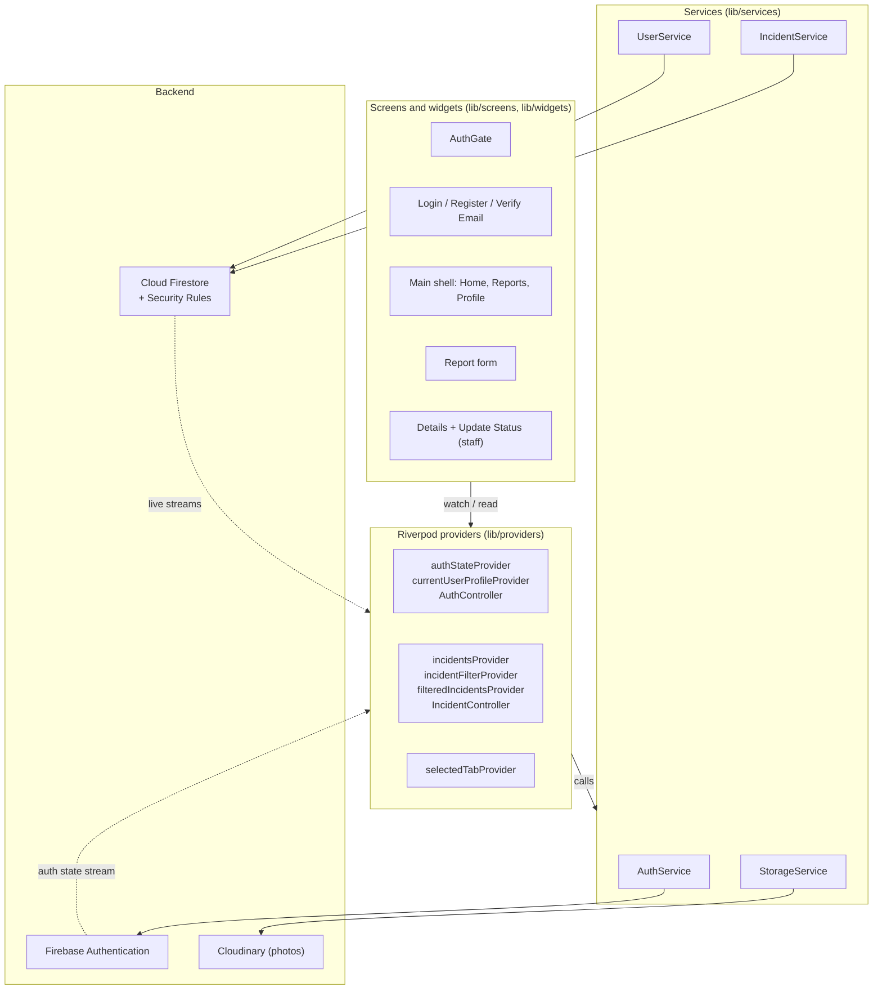
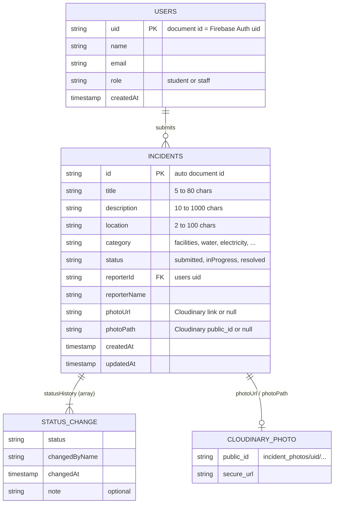

# Campus Incident Reporting App

A Flutter mobile app for African Leadership University (ALU). Students report campus problems such as broken facilities, water or power outages, damaged furniture, sanitation issues and safety concerns. Authorized staff review the reports and move them from **Submitted** to **In Progress** to **Resolved**.

Built with Flutter, Riverpod, Firebase Authentication, Cloud Firestore and Cloudinary.

---

## Table of Contents

1. [Features](#features)
2. [User Roles](#user-roles)
3. [Tech Stack](#tech-stack)
4. [Architecture](#architecture)
5. [Project Structure](#project-structure)
6. [Data Model](#data-model)
7. [Security Rules](#security-rules)
8. [Privacy and Misuse Protection](#privacy-and-misuse-protection)
9. [Getting Started](#getting-started)
10. [Testing](#testing)
11. [Errors We Hit and How We Fixed Them](#errors-we-hit-and-how-we-fixed-them)
12. [Known Limitations](#known-limitations)
13. [Future Improvements](#future-improvements)

---

## Features

### Authentication
- Register and log in with email and password.
- Sign up is limited to ALU emails: `@alustudent.com` (students) and `@alueducation.com` (staff).
- Email verification is required before any report can be created or read.
- Password reset by email.
- The session is remembered. The app opens on the right screen after it is closed and reopened.
- Logout from the Profile tab.

### Reporting
- Report form with category, title, description and location.
- Optional photo from the camera or gallery, uploaded to Cloudinary.
- Photos are resized (max 1600 px wide, 75% quality) before upload to save data.
- Form validation with clear messages under each field.
- Loading button while submitting, and success or error snackbars.
- Safety notice reminding students to contact security directly in an emergency.

### Browsing and Tracking
- Home screen with a banner and summary tiles (Total, Submitted, In Progress, Resolved).
- Tapping a summary tile opens the Reports tab already filtered by that status.
- Reports list with search (title, location, description), status filter tabs and category filter.
- Details page with the photo, all report fields and a status timeline.
- Activity history showing who changed the status, when, and any note they left.
- Live updates: a status change made by staff appears on the student's screen without a refresh.

### Staff
- Staff see every report on campus. Students see only their own.
- Staff can update the status and add a note for the student.
- Staff can delete any report. Students can delete their own report only while it is still Submitted.

---

## User Roles

| | Student | Staff |
|---|---|---|
| Who | Verified `@alustudent.com` account | Verified `@alueducation.com` account, or any account whose `role` is set to `staff` in the Firestore Console |
| Create reports | Yes | Yes |
| See reports | Only their own | All reports |
| Update status | No | Yes |
| Delete reports | Own reports while Submitted | Any report |

Roles are enforced in two places:
1. **In the app:** staff-only buttons and screens are hidden from students.
2. **In Firestore security rules:** the server refuses any request a user is not allowed to make, even if someone modifies the app.

### Testing the staff role without a staff email
1. Register a second account, for example `yourname+staff@alustudent.com`. Mail sent to it arrives in your normal inbox.
2. Verify the email.
3. In the Firebase Console, open **Firestore Database > Data > users**, find that account's document and change `role` from `student` to `staff`.
4. The app switches to staff mode by itself.

---

## Tech Stack

| Purpose | Package / Service |
|---|---|
| UI framework | Flutter (Dart SDK ^3.13) |
| State management | `flutter_riverpod` ^3.4.3 |
| Firebase setup | `firebase_core` ^5.1.0 |
| Authentication | `firebase_auth` ^7.0.1 |
| Database | `cloud_firestore` ^7.1.0 |
| Photo storage | Cloudinary (unsigned upload preset) via `http` |
| Camera and gallery | `image_picker` ^1.2.4 |
| Date formatting | `intl` ^0.20.3 |
| Unique IDs | `uuid` ^4.6.0 |

> **Why Cloudinary instead of Firebase Storage?** Firebase Storage now needs the paid Blaze plan for new projects, and the billing card could not be added. The facilitator approved Cloudinary for photo storage. Firebase Authentication and Cloud Firestore are still used for everything else.

---

## Architecture

The app is split into layers. Each layer only talks to the one below it, so Firebase code never appears inside a widget.



| Layer | Folder | Job |
|---|---|---|
| Models | `lib/models/` | Plain Dart classes for users, incidents, statuses, categories and filters. They convert to and from Firestore data. |
| Services | `lib/services/` | The only code that calls Firebase or Cloudinary. |
| Providers | `lib/providers/` | Riverpod providers that hold app-wide state and call the services. |
| Screens | `lib/screens/` | Full pages. They watch providers and show the result. |
| Widgets | `lib/widgets/` | Small reusable UI pieces such as cards, chips and the timeline. |
| Utils | `lib/utils/` | Validators, constants, theme, date helpers and error messages. |

### Main providers

| Provider | Type | Holds |
|---|---|---|
| `authStateProvider` | `StreamProvider<User?>` | The signed-in Firebase user, or null. Drives `AuthGate`. |
| `currentUserProfileProvider` | `StreamProvider<AppUser?>` | The user's Firestore profile, including their role. |
| `authControllerProvider` | `AsyncNotifierProvider` | Login, register, verify, reset and logout, with loading and error state. |
| `incidentsProvider` | `StreamProvider<List<Incident>>` | Live reports. All reports for staff, own reports for students. |
| `incidentFilterProvider` | `NotifierProvider` | Search text, status and category chosen on the Reports screen. |
| `filteredIncidentsProvider` | `Provider` | The report list after the filter is applied. |
| `incidentSummaryProvider` | `Provider` | Counts for the Home summary tiles. |
| `incidentByIdProvider` | `Provider.family` | One report by id, kept live for the Details page. |
| `incidentControllerProvider` | `AsyncNotifierProvider` | Submit, update status and delete, with loading and error state. |
| `selectedTabProvider` | `NotifierProvider` | Which bottom navigation tab is open. |

`setState` is only used for small local things that no other screen needs, such as the selected photo or a password visibility toggle.

### Submitting a report, step by step
1. The student fills in the form. Each field is checked by a validator.
2. `IncidentController.submit` sets the state to loading, so the button shows a spinner.
3. If there is a photo, `StorageService` uploads it to Cloudinary and gets back a link (`secure_url`) and an id (`public_id`).
4. `IncidentService.createIncident` saves the report in Firestore with status `submitted` and the first history entry.
5. Firestore security rules check the request on the server.
6. `incidentsProvider` receives the new report from its live stream, and every screen updates.
7. The form closes and a success message appears. If anything fails, a friendly error message is shown instead.

---

## Project Structure

```
lib/
├── main.dart                     # Starts Firebase and Riverpod, opens AuthGate
├── firebase_options.dart         # Generated by flutterfire configure
├── models/
│   ├── app_user.dart             # AppUser and UserRole (student / staff)
│   ├── incident.dart             # Incident and StatusChange
│   ├── incident_category.dart    # Category enum with labels and icons
│   ├── incident_filter.dart      # Search and filter logic, summary counts
│   └── incident_status.dart      # Status enum with labels, colours and icons
├── services/
│   ├── auth_service.dart         # Firebase Authentication calls
│   ├── user_service.dart         # users collection
│   ├── incident_service.dart     # incidents collection (CRUD)
│   └── storage_service.dart      # Cloudinary photo upload
├── providers/
│   ├── service_providers.dart    # Firebase instances, HTTP client, services
│   ├── auth_providers.dart       # Auth state, profile, AuthController
│   ├── incident_providers.dart   # Reports, filters, IncidentController
│   └── navigation_provider.dart  # Selected bottom tab
├── screens/
│   ├── auth/                     # AuthGate, login, register, verify email
│   ├── home/                     # Home with banner and summary
│   ├── reports/                  # List with search and filter tabs
│   ├── report_form/              # New report form
│   ├── details/                  # Details, timeline, staff status sheet
│   ├── profile/                  # Profile and logout
│   └── main_shell.dart           # Bottom navigation with IndexedStack
├── widgets/                      # Reusable UI components
└── utils/                        # Validators, theme, constants, helpers

test/
├── validators_test.dart
├── incident_filter_test.dart
└── widgets_test.dart

firestore.rules                   # Firestore security rules
firebase.json, .firebaserc        # Firebase CLI configuration
```

---

## Data Model



- **`users/{uid}`**: one document per account. The document id is the Firebase Auth uid.
- **`incidents/{id}`**: one document per report.
- **`statusHistory`** is an array inside each incident, not a separate collection. A report's history is always read together with the report, so this keeps it to one read.
- Sorting and filtering happen in the app, so no composite Firestore indexes are needed.
- Photos live in Cloudinary under `incident_photos/{uid}/`. Firestore only stores the link and id.

---

## Security Rules

The full rules are in [`firestore.rules`](firestore.rules). They run on Google's servers before every read and write.

| Rule | What it enforces |
|---|---|
| `hasAluEmail()` | The signed-in email ends in `@alustudent.com` or `@alueducation.com`. |
| `isVerified()` | ALU email **and** the email has been verified. |
| `isStaff()` | Verified, **and** either a `@alueducation.com` email or `role == 'staff'` in the user's profile. |
| `users` read | Your own profile, or any profile if you are staff. |
| `users` create | Only your own profile, with your real email. A new account can only call itself staff if it has a staff email. |
| `users` update | Only your own profile, and the role cannot change. |
| `incidents` read | Verified users read their own reports. Staff read all of them. |
| `incidents` create | Verified, in your own name, status must be `submitted`, text lengths checked, and any photo link must come from the app's Cloudinary account. |
| `incidents` update | Staff only, and only `status`, `statusHistory` and `updatedAt` may change. |
| `incidents` delete | Staff, or the owner while the report is still `submitted`. |

Deploy the rules with:

```bash
firebase deploy --only firestore:rules
```

---

## Privacy and Misuse Protection

- **Who sees what:** students only see their own reports. Only staff see everyone's.
- **ALU only:** sign up is restricted to ALU email domains, and the email must be verified.
- **Fake or abusive content:** reports are tied to a verified account and name, text lengths are limited, and photos must come from the app's own Cloudinary account.
- **Location data in photos:** report photos are re-encoded and resized by `image_picker` before upload. The banner image bundled with the app was resized from 3 MB to 0.4 MB and its GPS and camera EXIF data was removed.
- **No secrets in the app:** only the Cloudinary cloud name and the unsigned upload preset are in the code. The Cloudinary API secret is never included.
- **Safety:** the report form reminds students to contact campus security directly for emergencies.

---

## Getting Started

### Prerequisites
- Flutter SDK (3.47 or newer) and Dart SDK ^3.13
- Android Studio with an Android emulator, or a physical phone
- Java 17 or newer for Gradle. Android Studio's bundled JDK (`C:\Program Files\Android\Android Studio\jbr`) is enough.
- Node.js and the Firebase CLI: `npm install -g firebase-tools`
- FlutterFire CLI: `dart pub global activate flutterfire_cli`
- A Firebase project and a free Cloudinary account

### 1. Clone and install

```bash
git clone https://github.com/Airman-web/campus_incident_app.git
cd campus_incident_app
flutter pub get
```

### 2. Connect Firebase

```bash
firebase login
flutterfire configure
```

This creates `lib/firebase_options.dart` and `android/app/google-services.json`.

In the Firebase Console:
1. **Authentication > Sign-in method:** enable **Email/Password**.
2. **Firestore Database:** create the database.
3. Deploy the security rules: `firebase deploy --only firestore:rules`

### 3. Connect Cloudinary
1. On the Cloudinary Dashboard, copy your **Cloud name**.
2. Go to **Settings > Upload > Upload presets > Add upload preset**.
3. Set **Signing mode** to **Unsigned** and save. Copy the preset name.
4. Put both values in `lib/utils/constants.dart`:

```dart
const String cloudinaryCloudName = 'your-cloud-name';
const String cloudinaryUploadPreset = 'your-unsigned-preset';
```

5. Update the Cloudinary address in the `validPhotoUrl` rule in `firestore.rules` to match your cloud name, then deploy the rules again.

### 4. Run

```bash
flutter run
```

---

## Testing

Run all automated tests:

```bash
flutter test
```

Check the code for problems:

```bash
flutter analyze
```

| Test file | What it checks |
|---|---|
| `validators_test.dart` | ALU email check, staff email check, look-alike domains, password rules, text length rules |
| `incident_filter_test.dart` | Search, status filter, category filter, combined filters, summary counts |
| `widgets_test.dart` | `StatusChip` label, `StatusTimeline` pending steps, `timeAgo` text |

Manual tests carried out on the Android emulator:
- Register with a non-ALU email (rejected), register with an ALU email, verify, log in, log out.
- Submit a report with and without a photo, and see it in Firestore and Cloudinary.
- Search and filter reports, open the details page.
- Log in as staff, see all reports, update a status with a note, and see the student's timeline update.
- Try staff-only actions as a student and confirm they are refused.

---

## Errors We Hit and How We Fixed Them

### 1. `firebase deploy` said "No currently active project"
**Cause:** the Firebase CLI did not know which project to deploy to.
**Fix:** added a `.firebaserc` file that sets the default project:

```json
{ "projects": { "default": "campusincidentapp" } }
```

### 2. `firebase deploy` failed with HTTP 403 "Caller does not have required permission"
**Cause:** the Firebase CLI on the computer was signed in with a different Google account from the one that owns the project. `firebase login:list` showed the wrong email.
**Fix:**

```bash
firebase logout
firebase login      # choose the account that owns the project
firebase deploy --only firestore:rules
```

The message `Assertion failed: !(handle->flags & UV_HANDLE_CLOSING)` after `firebase logout` is a known Windows glitch in the CLI and can be ignored.

### 3. Firebase Storage could not be enabled
**Cause:** Firebase Storage needs the Blaze (pay as you go) plan for new projects. Adding the billing card kept looping back to the card form.
**Fix:** with the facilitator's approval, photos are uploaded to Cloudinary using an unsigned upload preset. `firebase_storage` was removed from the project.

### 4. Gradle needs Java 17, but `java -version` shows Java 8
**Cause:** the system Java is old, but Flutter does not use it.
**Fix:** nothing to install. Flutter uses the JDK bundled with Android Studio at `C:\Program Files\Android\Android Studio\jbr`. Check with `flutter doctor -v`.

### 5. Firestore warnings: "Failed to resolve name" / `EAI_NODATA (No address associated with hostname)`
**Cause:** the Android emulator lost its internet connection, so it could not find Google's servers. Firestore retries by itself, so these are warnings, not crashes.
**Fix:** in Android Studio's Device Manager, use **Cold Boot Now** on the emulator. This often happens after the PC sleeps or changes Wi-Fi.

### 6. The emulator camera got stuck when taking a photo
**Cause:** the emulator has no real camera and shows a slow virtual scene. After pressing the shutter, the camera app waits for the photo to be confirmed.
**Fix:** tap the **tick** button after taking the picture, or use **Choose from gallery** instead.

### 7. Dragging a photo onto the emulator said "APK will be installed"
**Cause:** the emulator treated the dropped file as an app.
**Fix:** either download an image inside the emulator with Chrome (press and hold the image, then **Download image**), or copy it from the PC with adb:

```powershell
& "$env:LOCALAPPDATA\Android\Sdk\platform-tools\adb.exe" push "C:\path\to\photo.jpg" /sdcard/Download/
```

Then pick it from the gallery's **Downloads** folder.

### 8. `adb` was "not recognized"
**Cause:** the Android SDK `platform-tools` folder is not on the system PATH.
**Fix:** run it with its full path: `$env:LOCALAPPDATA\Android\Sdk\platform-tools\adb.exe`.

### 9. Photo upload failed before Cloudinary was set up
**Cause:** the app was still uploading to Firebase Storage, which was never enabled.
**Fix:** `StorageService` was rewritten to upload to Cloudinary. After changing packages, the app must be fully stopped and started again with `flutter run`. Hot reload is not enough.

### 10. "You do not have permission to do that" right after verifying the email
**Cause:** Firebase only puts `email_verified: true` into the user's login token after the token is refreshed, and the security rules read that token.
**Fix:** after verification the app calls `user.reload()` and `getIdToken(true)` to fetch a fresh token before continuing.

### 11. `main.dart` suddenly reverted to the old starter code and would not build
**Cause:** the file in the editor went back to an old version (likely from repeated undo), with a stray `ReportBanner(),` line that broke the brackets.
**Fix:** compared it with the committed version (`git diff lib/main.dart`) and restored the correct file. The commits on GitHub were not affected.

### 12. Red "Undefined name" errors in VS Code while editing
**Cause:** the editor checks the code between edits, for example after a usage is added but before its import is.
**Fix:** none needed once all edits were in. `flutter analyze` reports no issues.

### 13. Kotlin plugin warning during `flutter build apk`
**Cause:** a version notice from the Android build tools.
**Fix:** harmless. The build still succeeds.

### 14. The banner photo contained GPS location data
**Cause:** the image was a 3 MB iPhone photo with EXIF data (GPS coordinates, camera model, orientation).
**Fix:** rotated it upright, resized it to 1200 x 1600 and saved a fresh copy without EXIF data (0.4 MB).

---

## Known Limitations

- **Photos are not deleted from Cloudinary** when a report is deleted. Deleting needs the Cloudinary API secret, which must never be shipped inside a mobile app. A server function would be needed to do this safely.
- **Staff are promoted by hand** in the Firestore Console when they do not have an `@alueducation.com` email. There is no admin screen.
- **Anyone with the unsigned preset can upload to Cloudinary.** The Firestore rules still stop those links from being attached to reports from other accounts, but the uploads themselves are not blocked.
- **No push notifications.** Students see status changes when they open the app.
- **Sorting and filtering run on the device**, which is fine for a campus but would need server-side queries and indexes for very large numbers of reports.

---

## Future Improvements

- A Cloud Function to delete Cloudinary photos and to sign uploads.
- Push notifications when a report's status changes.
- An admin screen for managing staff roles.
- Assigning reports to a specific staff member or department.
- Priority levels and response time tracking.
- Reporting statistics for campus management.

---

## Author

**[Your full name]**, African Leadership University

Repository: [github.com/Airman-web/campus_incident_app](https://github.com/Airman-web/campus_incident_app)
